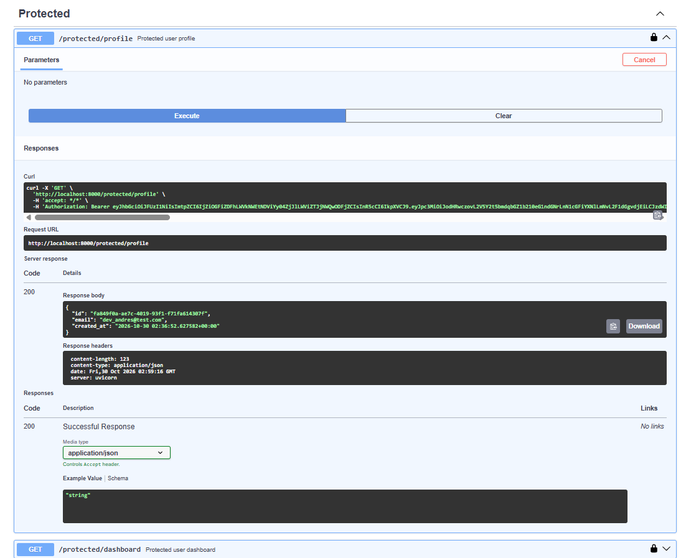

# Backend AI Engineering

Production-grade backend architectures, database migration layers, containerized stacks, and secure identity provider authentication built with Python, FastAPI, Docker, PostgreSQL, and Supabase Auth.

[](LICENSE)

## Repository Overview
- **`BE-01`**: In-Memory HTTP CRUD foundations and strict REST semantics.
- **`BE-02`**: Persistent SQLite storage with parameterized SQL queries.
- **`BE-04`**: Multi-container stack orchestration with Docker Compose, PostgreSQL server, and isolated volumes.
- **`BE-03`**: Enterprise Identity Provider (IdP) integration with Supabase Auth, JSON Web Tokens (JWT), reusable FastAPI dependencies, and route protection.

---

## Module: BE-03 — Auth: Login & Protect

### Architectural Principles: The Trust Triangle
This module enforces zero-trust access control by delegating user credential storage, password hashing, and cryptographic signing to an external Identity Provider (**Supabase Auth**):
1. **Credentials Delegation**: The client passes email and password to Supabase; our backend never stores plain passwords or hashes them manually.
2. **Cryptographic Passes**: Supabase issues signed JSON Web Tokens (JWTs) with an expiration lifespan.
3. **Route Interception**: Protected routes extract the bearer token from the `Authorization: Bearer <token>` header and cryptographically verify the session via `supabase.auth.get_user(token)`.
4. **Reusable Guards**: Verification logic is encapsulated in a FastAPI `Depends(get_current_user)` dependency, securing multiple routes without code duplication.

### Quickstart

```powershell
# 1. Clone repository
git clone [https://github.com/AndruMark/backend-ai-engineering.git](https://github.com/AndruMark/backend-ai-engineering.git)
cd backend-ai-engineering

# 2. Activate virtual environment & install dependencies
.\.venv\Scripts\Activate.ps1
pip install -r requirements.txt

# 3. Configure environment variables
Copy-Item .env.example .env
# Edit .env and supply your SUPABASE_URL and SUPABASE_KEY (anon public key)

# 4. Launch API server
uvicorn main:app --reload --port 8000
```

### Endpoints Specification

| HTTP Method | Endpoint | Auth Required | Expected Status Codes | Description |
| :--- | :--- | :--- | :--- | :--- |
| `GET` | `/` | No | `200 OK` | API root metadata and discovery catalog |
| `GET` | `/health` | No | `200 OK` | Server health check probe |
| `POST` | `/auth/signup` | No | `201 Created` / `400 Bad Request` | Registers new user account in Supabase |
| `POST` | `/auth/login` | No | `200 OK` / `400 Bad Request` / `401 Unauthorized` | Authenticates user & issues access/refresh tokens |
| `POST` | `/auth/logout` | **Yes (Bearer)** | `204 No Content` / `401 Unauthorized` | Ends session via Supabase signOut |
| `GET` | `/public/info` | No | `200 OK` | Publicly accessible information |
| `GET` | `/protected/profile` | **Yes (Bearer)** | `200 OK` / `401 Unauthorized` | Returns verified user identity metadata |
| `GET` | `/protected/dashboard` | **Yes (Bearer)** | `200 OK` / `401 Unauthorized` | Secondary protected view verifying guard reuse |

---

## Interactive API Documentation & Swagger UI
Interactive docs available at `http://localhost:8000/docs`.  
Authentication is integrated via the OpenAPI `HTTPBearer` security scheme.



---

## Technical Benchmarks & AI Rematch

### Stage 7 (BE-01): In-Memory AI vs Me
- Enforced strict custom JSON error structures over default framework exceptions.
- Applied input whitespace sanitization to prevent empty/blank title records.

### Stage 6 (BE-02): SQLite Persistence AI vs Me
- Guarded database seeding with `SELECT COUNT(*) FROM tasks` to prevent duplicate seed rows across application restarts.
- Structured database rows using `conn.row_factory = sqlite3.Row` for schema integrity.

### Stage 6 (BE-04): Containerized Stack AI vs Me
- Resolved container DNS naming (`db:5432`) over broken `localhost:5432` configurations.
- Enforced Docker named volumes (`taskdata`) for true data persistence and added `pg_isready` health checks.
