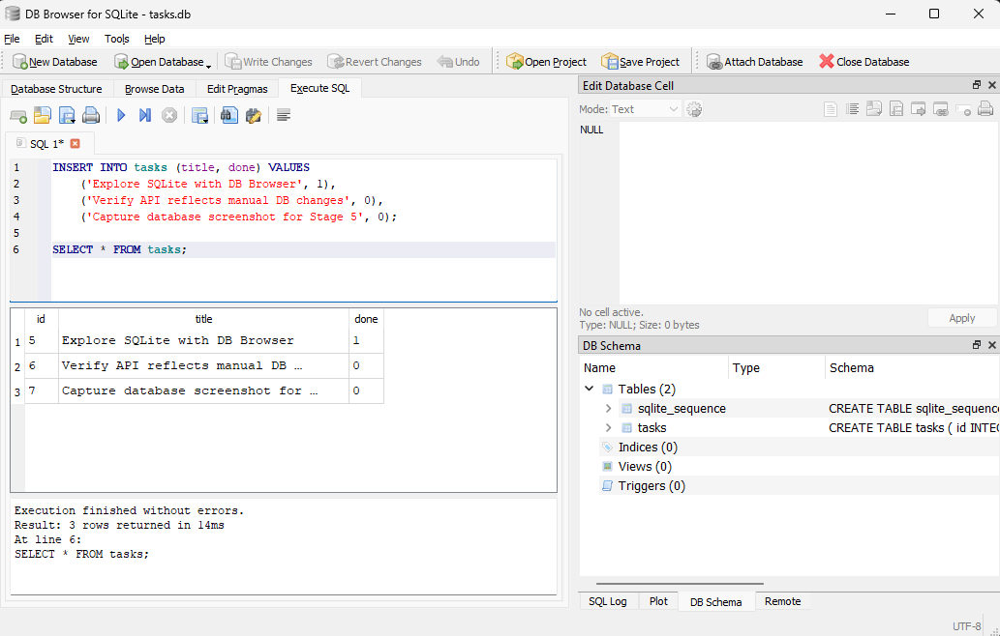
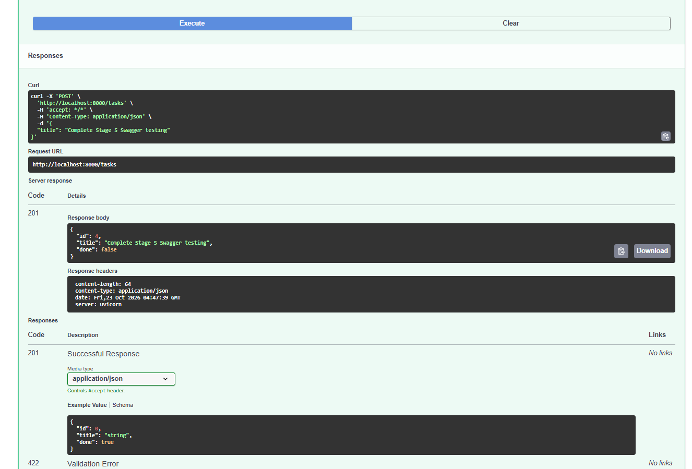

# Backend AI Engineering

Production-ready backend services, foundational API architectures, and persistent database layers built with Python and FastAPI.

[](LICENSE)

## Repository Overview
This repository contains progressive backend engineering modules:
- **`BE-01`**: Foundations — In-Memory RESTful CRUD API with strict HTTP semantics, Pydantic validation, and OpenAPI documentation.
- **`BE-02`**: Persistence — Transition to disk-backed relational storage using SQLite and raw parameterized SQL queries without breaking API contracts.
- *(Upcoming Modules)*: Relational & Vector database persistence (PostgreSQL / pgvector), asynchronous queues, and LLM agent tool interfaces.

---

## Module: BE-02 — Persistent SQLite CRUD Task API

### Architectural Principles: Separation of Concerns
In this module, the storage layer was migrated from transient in-memory memory structures to a persistent SQLite database (`tasks.db`). 

A key takeaway of backend engineering:
> **APIs define the interface contract** (*what the application does*).  
> **Databases define the persistence layer** (*where data is stored*).

The client continues to send the exact same HTTP requests to the exact same endpoints. Only the underlying data access mechanism changed, guaranteeing full data persistence across application restarts.

### Why SQLite?
- **Zero Server Setup**: Operates as a self-contained, serverless embedded database engine stored inside a single file (`tasks.db`).
- **Deterministic Reliability**: Highly resilient and acid-compliant, making it ideal for localized backend services and edge architectures.
- **Automated Lifecycle**: Missing database files and schemas are generated on application startup, running initial seed data only when the table is empty (`COUNT(*) == 0`).

### Getting Started

#### 1. Setup Environment
```powershell
git clone [https://github.com/AndruMark/backend-ai-engineering.git](https://github.com/AndruMark/backend-ai-engineering.git)
cd backend-ai-engineering
python -m venv .venv
.\.venv\Scripts\Activate.ps1
pip install -r requirements.txt
```

#### 2. Run the Server
```powershell
uvicorn main:app --reload --port 8000
```
*Note: On first startup, `tasks.db` is initialized automatically and seeded with 3 example tasks.*

### Endpoints Specification

| HTTP Method | Endpoint | Underlying SQL Operation | Status Code |
| :--- | :--- | :--- | :--- |
| `GET` | `/` | API Root Metadata | `200 OK` |
| `GET` | `/health` | Server Health Check probe | `200 OK` |
| `GET` | `/tasks` | `SELECT id, title, done FROM tasks` | `200 OK` |
| `GET` | `/tasks/{id}` | `SELECT id, title, done FROM tasks WHERE id = ?` | `200 OK` / `404 Not Found` |
| `POST` | `/tasks` | `INSERT INTO tasks (title, done) VALUES (?, ?)` | `201 Created` / `400 Bad Request` |
| `PUT` | `/tasks/{id}` | `UPDATE tasks SET title = ?, done = ? WHERE id = ?` | `200 OK` / `400 Bad Request` / `404 Not Found` |
| `DELETE` | `/tasks/{id}` | `DELETE FROM tasks WHERE id = ?` | `204 No Content` / `404 Not Found` |

### Parameterized Query Security
All SQL execution uses parameterized placeholders (`?`) rather than string interpolation, preventing SQL injection vulnerabilities:

```python
cursor.execute("SELECT id, title, done FROM tasks WHERE id = ?", (task_id,))
```

### Visual Database Inspection (DB Browser for SQLite)
Direct SQL execution and table inspection executed on `tasks.db`:

```sql
SELECT * FROM tasks;
```



---

## Interactive API Documentation (Swagger UI)
Interactive OpenAPI documentation is served at `http://localhost:8000/docs`.



---

## Technical Benchmarks & AI Rematch

### Stage 7 (BE-01): In-Memory AI vs Me
- Documented adherence to custom error structures (`{"error": "Task not found"}`) vs default framework exceptions.
- Enforced input whitespace stripping sanitization.
- Guaranteed RFC-compliant empty-body 204 No Content response semantics.

### Stage 6 (BE-02): SQLite Persistence AI vs Me Benchmark

#### Comparative Findings:
1. **Idempotent Seeding Logic**: The naive AI implementation ran raw `INSERT` queries on startup without checking `COUNT(*)`, causing seed tasks to duplicate endlessly on every server restart. The production code guards seeds with `SELECT COUNT(*) FROM tasks`.
2. **Result Serialization**: The AI baseline returned raw SQLite tuples (`(1, 'Task', 0)`) to the client, breaking JSON schema compatibility. The production implementation uses `conn.row_factory = sqlite3.Row` and mapped Pydantic models to preserve camelCase/object contracts.
3. **Connection Lifecycle & Resource Leaking**: The AI code omitted proper connection error handling and connection pooling closures.
