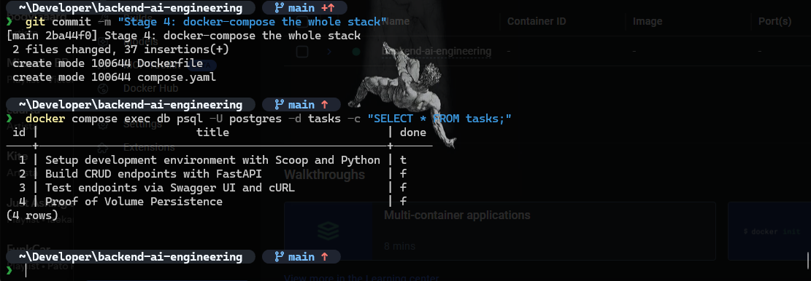

# Backend AI Engineering

Production-grade backend architectures, database migration layers, and containerized stacks built with Python, FastAPI, Docker, and PostgreSQL.

[](LICENSE)

## Repository Overview
- **`BE-01`**: In-Memory HTTP CRUD foundations and strict REST semantics.
- **`BE-02`**: Persistent SQLite storage with parameterized SQL queries.
- **`BE-04`**: Multi-container stack orchestration with Docker Compose, PostgreSQL server, isolated volumes, and environment secrets.

---

## Module: BE-04 — Containerized PostgreSQL Stack

### Architectural Principles
This module migrates storage to an enterprise-grade relational database running inside an isolated Docker container, orchestrated alongside the FastAPI application via Docker Compose.

Key guarantees:
- **Unified Execution**: The entire stack (API + Database) starts with a single command: `docker compose up`.
- **Strict Secret Segregation**: Database credentials live solely in `.env` (gitignored), documented via `.env.example`.
- **True Persistence**: Database state survives full stack teardowns (`docker compose down`) via Docker named volumes (`taskdata`).
- **Unbroken Contracts**: Route signatures and HTTP status codes (`200`, `201`, `204`, `400`, `404`) remain identical across memory, SQLite, and PostgreSQL.

### Quickstart (One-Command Deployment)

```powershell
# 1. Clone repository
git clone [https://github.com/AndruMark/backend-ai-engineering.git](https://github.com/AndruMark/backend-ai-engineering.git)
cd backend-ai-engineering

# 2. Configure environment
Copy-Item .env.example .env

# 3. Launch stack
docker compose up -d --build
```

### Endpoints Specification

| HTTP Method | Endpoint | Underlying SQL Operation | Status Code |
| :--- | :--- | :--- | :--- |
| `GET` | `/` | API Root Metadata | `200 OK` |
| `GET` | `/health` | Server Health Check probe | `200 OK` |
| `GET` | `/tasks` | `SELECT id, title, done FROM tasks ORDER BY id ASC;` | `200 OK` |
| `GET` | `/tasks/{id}` | `SELECT id, title, done FROM tasks WHERE id = %s;` | `200 OK` / `404 Not Found` |
| `POST` | `/tasks` | `INSERT INTO tasks (title, done) VALUES (%s, %s) RETURNING id, title, done;` | `201 Created` / `400 Bad Request` |
| `PUT` | `/tasks/{id}` | `UPDATE tasks SET title = %s, done = %s WHERE id = %s RETURNING id, title, done;` | `200 OK` / `400 Bad Request` / `404 Not Found` |
| `DELETE` | `/tasks/{id}` | `DELETE FROM tasks WHERE id = %s RETURNING id;` | `204 No Content` / `404 Not Found` |

### Database Inspection inside Container
```bash
docker compose exec db psql -U postgres -d tasks -c "SELECT * FROM tasks;"
```



---

## Interactive API Documentation
Served at `http://localhost:8000/docs`.


---

## Technical Benchmarks & AI Rematch

### Stage 7 (BE-01): In-Memory AI vs Me
- Enforced strict custom JSON error structures over default framework exceptions.
- Applied input whitespace sanitization to prevent empty/blank title records.

### Stage 6 (BE-02): SQLite Persistence AI vs Me
- Guarded database seeding with `SELECT COUNT(*) FROM tasks` to prevent duplicate seed rows across application restarts.
- Structured database rows using `conn.row_factory = sqlite3.Row` for schema integrity.

### Stage 6 (BE-04): Containerized Stack AI vs Me Benchmark

#### Prompt Used:
> "Containerize a FastAPI CRUD task API connecting to a PostgreSQL database using Docker Compose. Ensure data persists across container restarts, credentials are read securely from environment variables, the database seeds initial tasks only once on startup, and both services start together with a single command."

#### Comparative Findings:
1. **Network Host Addressing Flaw**: The AI version configured `DATABASE_URL` with `localhost:5432` inside the API container. In Docker Compose networks, inter-container communication requires resolving the service name (`db:5432`), causing immediate connection failure in the AI build.
2. **Missing Volume Persistence**: The naive compose omitted `volumes: [taskdata:/var/lib/postgresql/data]`. As a result, running `docker compose down` and `up` wiped all database state, violating the core persistence requirement.
3. **Absence of Dependency Readiness Probes**: The AI configuration lacked healthcheck synchronization (`depends_on: condition: service_healthy` with `pg_isready`), triggering race-condition crashes in the API before the database socket was ready to accept TCP traffic.
